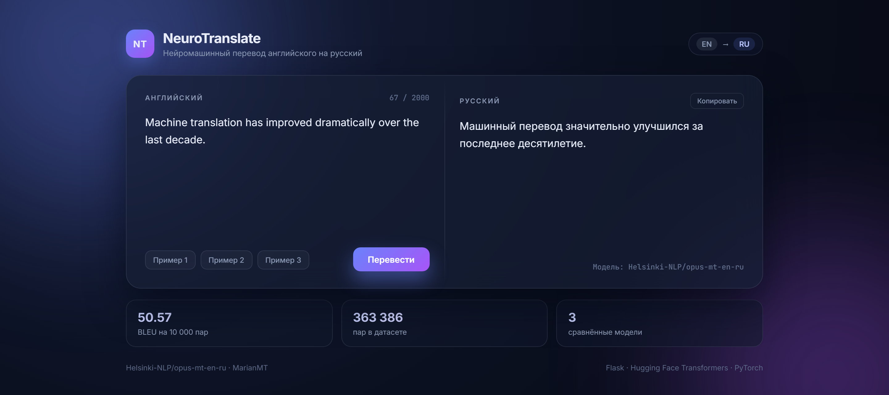

# NeuroTranslate — автоматический перевод текста EN → RU

Сравнение трёх нейросетевых моделей перевода с английского на русский по метрике **BLEU**, выбор лучшей и обёртка вокруг неё в виде веб-интерфейса.



<p>
  
  
  
  
  
  
</p>

## О проекте

Задача — не просто запустить готовый переводчик, а **обоснованно выбрать модель**: три кандидата прогоняются по одному и тому же параллельному корпусу, качество измеряется метрикой BLEU, победитель становится движком веб-приложения.

Что внутри:

- **Бенчмарк** — Jupyter-ноутбук и CLI-скрипт, которые считают corpus BLEU на 10 000 парах предложений.
- **Лучшая модель** — `Helsinki-NLP/opus-mt-en-ru` (MarianMT), 77M параметров, быстро работает даже на CPU.
- **Веб-интерфейс** — Flask-приложение с двуязычными панелями, счётчиком символов и копированием результата.
- **REST API** — эндпоинт `POST /api/translate` для интеграции.
- **Docker** — образ с healthcheck, готовый к запуску одной командой.
- **Streamlit-песочница** — интерактивное сравнение моделей с оценкой BLEU на эталонных переводах.

## Результаты сравнения

Датасет: [english-russian dictionary for machine translation](https://www.kaggle.com/datasets/hijest/englishrussian-dictionary-for-machine-translate/data) — 363 386 пар предложений. Оценка на случайной выборке из 10 000 пар, метрика `sacrebleu.corpus_bleu`.

| Модель | Архитектура | BLEU | Комментарий |
|---|---:|:---:|---|
| **Helsinki-NLP/opus-mt-en-ru** | MarianMT | **50.57** | Победитель, используется в приложении |
| facebook/wmt19-en-ru | FSMT | 42.20 | Тяжелее (~1.2 ГБ), качество ниже |
| google-t5/t5-base | T5 | 0.05 | Не обучена на перевод — бесполезна без fine-tuning |

Модель-победитель обучена именно на паре en-ru, поэтому даёт связные переводы общего назначения и укладывается в доли секунды на коротких текстах.

## Быстрый старт

### Локально

```bash
git clone https://github.com/d1m40fficial/AutomaticTextTranslation.git
cd AutomaticTextTranslation

python -m venv .venv
# Windows: .venv\Scripts\activate
source .venv/bin/activate
pip install -r requirements.txt

python app.py
```

Приложение: http://localhost:5000 — при первом запуске модель (~300 МБ) скачается с Hugging Face и закэшируется.

### Docker

```bash
docker build -t neurotranslate .
docker run -p 5000:5000 neurotranslate
```

### Streamlit-песочница

```bash
streamlit run streamlit_app.py
```

## API

```bash
curl -X POST http://localhost:5000/api/translate \
  -H "Content-Type: application/json" \
  -d '{"text": "Machine translation has improved dramatically."}'
```

```json
{ "translation": "Машинный перевод значительно улучшился." }
```

Служебный эндпоинт `GET /health` возвращает имя модели и устройство (`cuda` / `cpu`).

## Как это работает

```
Текст на английском
        │
        ▼
  AutoTokenizer (MarianSPM)
        │  input_ids
        ▼
  MarianMT: en-ru (77M)
        │  beam search
        ▼
  Decode → русский текст
```

- Модель загружается **лениво и один раз на процесс** (`translator.load()`), поэтому последующие запросы не платят за инициализацию.
- Устройство выбирается автоматически: `cuda`, если доступна, иначе `cpu`.
- Генерация идёт в `torch.inference_mode()` с `num_beams=4` — компромисс между качеством и скоростью.
- Входные данные ограничены 2000 символами в веб-форме и 512 токенами на уровне модели.

## Структура проекта

```
AutomaticTextTranslation/
├── app.py                      # Flask-приложение: UI, JSON API, /health
├── translator.py               # загрузка модели и функция translate()
├── streamlit_app.py            # интерактивное сравнение моделей
├── templates/index.html        # разметка интерфейса
├── static/css/style.css        # оформление
├── evaluation/evaluate_bleu.py # CLI-бенчмарк по BLEU
├── notebooks/
│   └── Automatic_text_translation.ipynb  # исходный эксперимент
├── data/README.md              # как получить датасет (сам rus.txt не хранится в git)
├── docs/screenshot.png
├── Dockerfile
└── requirements.txt
```

## Воспроизведение бенчмарка

Скачайте датасет (инструкция в [data/README.md](data/README.md)), затем:

```bash
python evaluation/evaluate_bleu.py --data data/rus.txt --sample 10000
```

Скрипт печатает прогресс по каждой модели и итоговую таблицу с BLEU. Полный эксперимент с загрузкой данных, оценкой и интерактивным переводом — в [ноутбуке](notebooks/Automatic_text_translation.ipynb).

## Ограничения

- Перевод **пословный по стилю**: модель не сохраняет форматирование, Markdown и переносы строк.
- Специализированная лексика (медицина, юриспруденция, IT-сленг) переводится нестабильно.
- Длинные тексты обрезаются по 512 токенам — для документов нужна сегментация по предложениям.
- BLEU измеряет совпадение n-грамм, а не смысл: оценка чувствительна к формулировке эталона.

## Стек

`Python` · `PyTorch` · `Hugging Face Transformers` · `Flask` · `Streamlit` · `sacrebleu` · `Docker`
